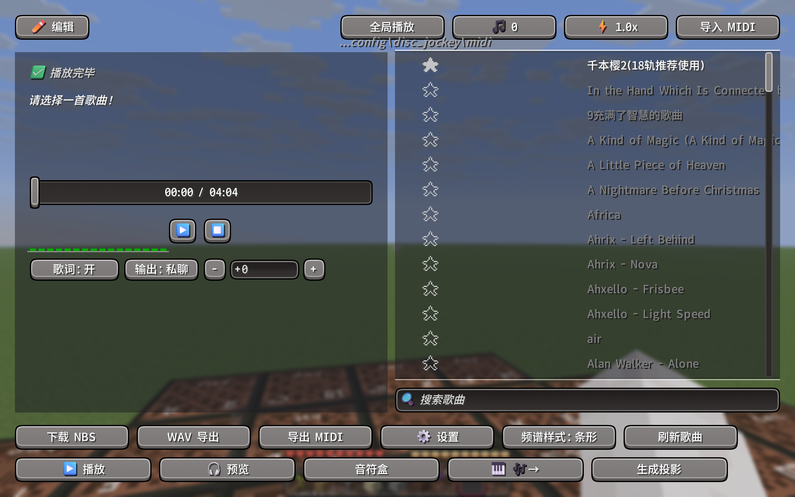
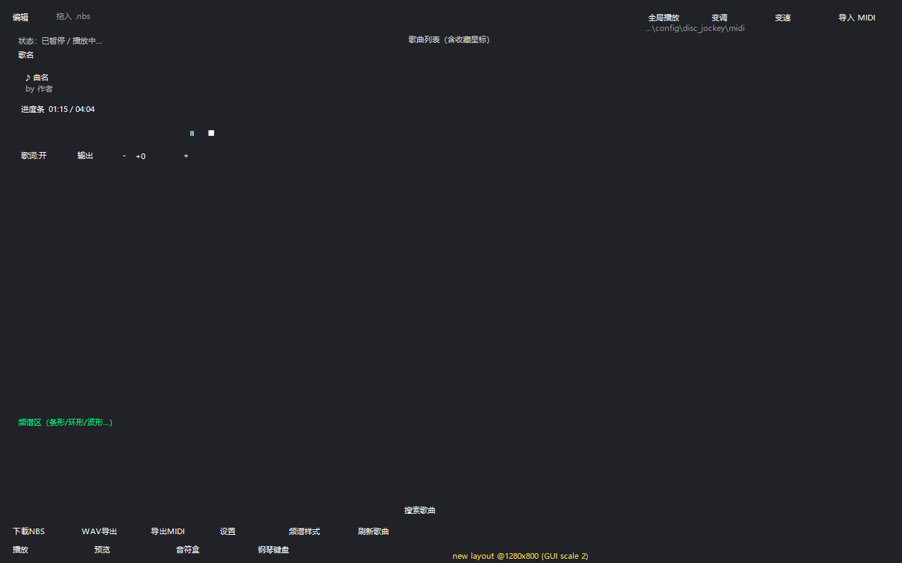

# 🎧 Disc Jockey Plus · Fabric 26.3

> 在 Minecraft 里用**音符盒**演奏你的歌单 —— NBS / MIDI 歌曲播放、频谱可视化、88 键钢琴、歌词同步、导入导出一条龙。

**本仓库**是 [SQL-MC/DJP-2.x](https://github.com/SQL-MC/DJP-2.x) 在 **Minecraft 26.3 / Fabric** 上的可编译版本，修复了原仓库的构建问题，并**重排了主界面布局**（不再拥挤、不再互相遮挡）。



| 项 | 值 |
|---|---|
| Minecraft | **26.3**（Fabric） |
| 加载器 | Fabric Loader ≥ 0.19.5 |
| 依赖 | [Fabric API](https://modrinth.com/mod/fabric-api) · [Cloth Config](https://modrinth.com/mod/cloth-config)（必需） · [ModMenu](https://modrinth.com/mod/modmenu)（可选） · [PianoLib](https://modrinth.com/mod/pianolib)（可选，88 键钢琴采样） |
| 协议 | MIT（[PianoLib](https://github.com/SQL-MC/PianoLib) 为 CC0） |

---

## 📌 版本说明（废弃提醒）

| 版本 | 状态 | 说明 |
|---|---|---|
| **2.9.3** | ✅ **推荐使用** | 投影改为**平面舞台**布局，音符盒全在脚下一层、都够得到 |
| 2.9.2 | ❌ **已废弃**（Release 已删除） | 3D 球壳投影布局有问题，很多音符盒被挡住/够不到，请勿使用 |
| 2.9.1 | ⚠️ 旧版 | 只有构建修复 + 界面重排，没有投影功能 |

> 2.9.2 的 Release 和 tag 已从仓库删除；如果需要旧版行为，请直接使用 **2.9.3**（投影布局已修正）。

---

## ✨ 功能一览

### 🎵 播放
- 读取 `config/disc_jockey/songs/` 下的 **.nbs** 歌曲（也支持导入 .mid 转换）
- 歌单列表：**收藏星标**、就近置顶、**搜索**（支持中文/文件名模糊匹配）、双击播放
- 播放控制：**播放 / 暂停 / 停止 / 进度拖动 / 循环 / 变速（⚡）/ 变调（🎵）**
- 播放时自动敲击半径内的**音符盒**（生存模式；创造模式会自动提示原因）
- 音符盒**数量检测**（半径 8 格统计，判断当前曲目所需音符够不够）

### 📣 预览 & 全局广播
- **预览**：本地听效果，不消耗方块、不动游戏世界
- **全局播放**：管理员用 `playsound` 推给全服玩家，所有人同步听歌（需要 OP）

### 📝 歌词
- 自动解析歌曲自带的歌词文件
- 输出方式：**公屏 / 仅自己** 一键切换
- 歌词偏移 **±0.5 秒** 微调，自动保存到配置

### 📊 频谱可视化
- 5 种样式：**条形 / 镜像 / 环形 / 波形 / 粒子**
- 界面内实时渲染；退出界面后 **HUD 仍在显示**（守护线程驱动）
- 与官方 `SpectrumVisualizer` 数据链路打通，观感一致

### 🔁 导入 / 导出
- **导入 MIDI**（文件选择器，自动转 NBS）
- **导出 NBS**（从 GitHub 下载歌曲库 / 导出当前曲目）
- **导出 MIDI**（`.mid` 标准 MIDI 文件）
- **导出 WAV**（离线渲染成音频文件）

### 🎹 钢琴 & 编辑
- **88 键钢琴键盘界面**（默认 `P` 键）—— 配合 PianoLib 使用钢琴采样音色
- **音符盒编辑器**：可视化查看/修改歌曲音符
- **音符盒扫描**：一键统计周围音符盒

### 🧱 一键生成投影（本仓库新增）
音符盒的"音色"由**下方方块**决定（石=底鼓、沙=军鼓、玻璃=踩镲、木板=贝斯、黏土=长笛、金块=钟…），
所以以前每首歌都要手动摆方块、还要等它自己调音高。

> ⚠️ 早期 2.9.2 的 3D 球壳投影布局已废弃（很多方块够不到），详见 [DEPRECATED-2.9.2.md](DEPRECATED-2.9.2.md)。

现在可以直接让模组**按当前歌曲自动生成 Litematica 投影**，而且**全部音符盒铺成一层大平面舞台**：
你站在中间，所有音符盒都在脚下同一层、一眼看清、伸手可及（不会有藏在里面够不到的）。

1. 在歌单里选一首歌 → 点底部 **「生成投影」**（或输入 `/discjockey schematic [歌名]`）
2. 模组算出这首歌需要的全部 **音色 + 音高** 组合，铺成平面（每个音符盒**正下方**放对应音色方块），
   输出 `schematics/dj_<歌名>.litematic`
3. 打开 Litematica 加载这个投影，把**橙色原点角块对齐到你脚下那格**
4. 用 **litematica-printer** 一键打印 → 站在舞台中间 → 回 DJP 点播放

**⚠️ 生成前准备空地**：音符盒需要脚下两格都是空的（脚下 1 格放音符盒，再下 1 格放音色方块）。
最方便的做法是**站在一根 1×1 的柱子顶上生成**（周围脚下两格都是空气），或者把地面挖掉两层。

如果空位不够，聊天栏会提示还有多少音符放不下（换个更空旷的位置再生成即可）。

---

## 💻 指令

| 指令 | 作用 |
|---|---|
| `/discjockey` | 打开主界面 |
| `/discjockey schematic [歌名]` | **按歌曲生成投影**（不填歌名 = 当前播放/选中的歌） |
| `/discjockey help` | 查看全部子指令 |
| `/discjockey transpose <±半音>` | 移调 |
| `/discjockey status` | 查看播放/调音状态 |

### ⚙️ 配置
- 基于 **Cloth Config** 的图形化配置（ModMenu → Disc Jockey Plus）
- 收藏、歌词偏移、输出方式、频谱样式等自动保存

---

## ⌨️ 默认快捷键

| 键 | 功能 |
|---|---|
| `J` | 打开 / 关闭主界面 |
| `P` | 钢琴键盘界面 |
| `M` | 预览静音开关 |
| `L` | 循环播放开关 |
| `B` | DJ 模式 |
| `[` / `]` | 移调 −1 / +1 |

> 都能在「选项 → 控制 → 按键绑定 → Disc Jockey Plus」里改。

---

## 📦 安装

1. 安装 **Fabric Loader**（≥ 0.19.5）与 **Fabric API**
2. 安装 **Cloth Config**（必需），可选装 **ModMenu**（配置入口）、**PianoLib**（钢琴采样）
3. 把 `disc_jockey_plus-2.9.3.jar` 丢进 `mods/`
4. 进游戏按 `J` 打开界面，选歌 → 播放
5. 首次启动会生成 `config/disc_jockey/`，把 `.nbs` 歌曲放进去（或用界面里的「下载 NBS」）

### ⚠️ 注意事项
- **创造模式不能播放**：原版规则下创造模式无法敲击音符盒，模组会直接提示，切到生存即可
- **全局广播需要 OP**：靠 `playsound` 实现，普通玩家只能自己听
- **PianoLib 是可选的**：不装也能用，只是没有额外的钢琴音色
- 播放需要你**周围有音符盒**（可先用「音符盒」按钮检测数量）

---

## 🔨 从源码构建

环境要求：**JDK 25**、**Gradle 9.8.x**（仓库自带 wrapper）、Fabric Loom **1.18.x（非 remap 变体）**

```bash
./gradlew build
# 产物：build/libs/disc_jockey_plus-2.9.1.jar
```

> ⚠️ `gradle.properties` 里的 `org.gradle.java.home` 指向 JDK 25 的安装路径，**请按你自己机器修改**（或删掉该行、用 `JAVA_HOME`）。

为什么用 `net.fabricmc.fabric-loom` 而不是 `fabric-loom`？
因为 **Minecraft 26.1 起官方已取消混淆**，不再需要 yarn/mojmap 映射，也不再有 `remapJar`；依赖直接用 `implementation` 即可（详见 [Fabric 文档](https://docs.fabricmc.net/develop/loom/)）。

---

## 🛠 本仓库相对上游（v2.9.1 原版）的改动

### 1. 修复构建（原仓库拉下来直接编不了）
- `gradle.properties`：`org.gradle.java.home` 原来是作者本机的 `C:\Program Files\Java\jdk-25`，改为可配置/本机路径
- `build.gradle`：删除 `implementation files('D:/pianolib-1.0.3+DJP2.7.3.jar')`（硬编码的本地 jar）。
  **说明**：DJP 对 PianoLib 全部是**运行时反射调用**，没有任何编译期 import，所以编译不需要该 jar，
  运行时把 PianoLib 一起装进 mods 即可。

### 2. 界面重排（`DiscJockeyScreen`，v2 布局）
- **顶部**：左侧「编辑」+ 右侧四个等宽控件（全局播放 / 变调 / 变速 / 导入 MIDI），统一 20px 高、6px 间距；
  原来压在歌单上的 MIDI 路径文字移到按钮下方居中
- **左侧播放器面板**：状态 → 歌名 → 曲名/作者卡片 → 进度条 → ⏸⏹ → 歌词行，逐行分层，**不再互相重叠**
- **底部两排按钮**：导出/设置/样式/刷新 一排，播放/预览/音符盒/钢琴/生成投影 一排，统一宽度与间距，不再挤在一起
- **歌单**：左右两栏 44% : 56%，列表占满右栏，搜索框贴右栏底部
- **频谱**：从屏幕底边移进左侧面板下方区域，五种样式都不会溢出面板
- 布局按 1280×800（GUI Scale 2）设计，同时用屏幕比例计算，1080p / 2K 全屏也保持间距



### 3. 新增「生成投影」（`SchematicExporter`，v2.9.3）
- 新增 `SchematicExporter`：解析当前歌曲的 (音色, 音高) 组合，**铺成一层平面舞台**
  （音符盒全部在同一层、正下方放对应音色方块，玩家站在中间；手长 4.5 格内、全部可见可点），
  导出 Litematica `.litematic`
- 界面新增按钮 **「生成投影」**；指令新增 `/discjockey schematic [歌名]`
- 投影原点对齐到"玩家脚下那格"，把橙色角块放到脚下即可用 printer 一键打印

---

## 📄 许可证与致谢

- 本项目沿用上游 **MIT** 许可证，见 [LICENSE](LICENSE)
- 原始作者：**SQL_MC**、**SRomanceS**（coders）、**SemmieDev**、**EnderKill98**（contributors）
- 本仓库维护：**Cetacea** —— 26.3 构建修复 + 界面重排
- 钢琴采样库：[PianoLib](https://github.com/SQL-MC/PianoLib)（CC0）
- 上游项目：[Disc Jockey Plus](https://modrinth.com/mod/disc-jockey-plus) / [GitHub](https://github.com/SQL-MC/DJP-2.x)

> 这不是 Mojang / Microsoft 官方项目。

---

## 🌐 English Summary

**Disc Jockey Plus** for **Minecraft 26.3 / Fabric** — play note-block songs from NBS/MIDI files, with a song browser (favorites + search), playback controls (pause/stop/seek/loop/speed/transpose), lyric sync (public/private + offset), 5 spectrum visualizer styles (also shown on the HUD), MIDI import & NBS/MIDI/WAV export, an 88-key piano GUI, a note-block song editor, and **one-click Litematica schematic generation** for the selected song.

This fork is a rebuild of [SQL-MC/DJP-2.x](https://github.com/SQL-MC/DJP-2.x) that:
1. fixes the hardcoded JDK path and the local PianoLib jar dependency (it is only used via reflection at runtime),
2. **redesigns the main screen layout** into a clean two-column UI with two tidy button rows, no more overlapping widgets,
3. **adds schematic export** (`SchematicExporter` / `/discjockey schematic`): builds the note-block machine a song needs (instrument blocks under each note block, correct pitches) within vanilla reach, ready to print with litematica-printer.

Requirements: Fabric Loader ≥ 0.19.5, Fabric API, Cloth Config; optional: ModMenu, PianoLib.
Build with **JDK 25** and Gradle 9.8.x (Loom non-remap variant). Licensed MIT.
